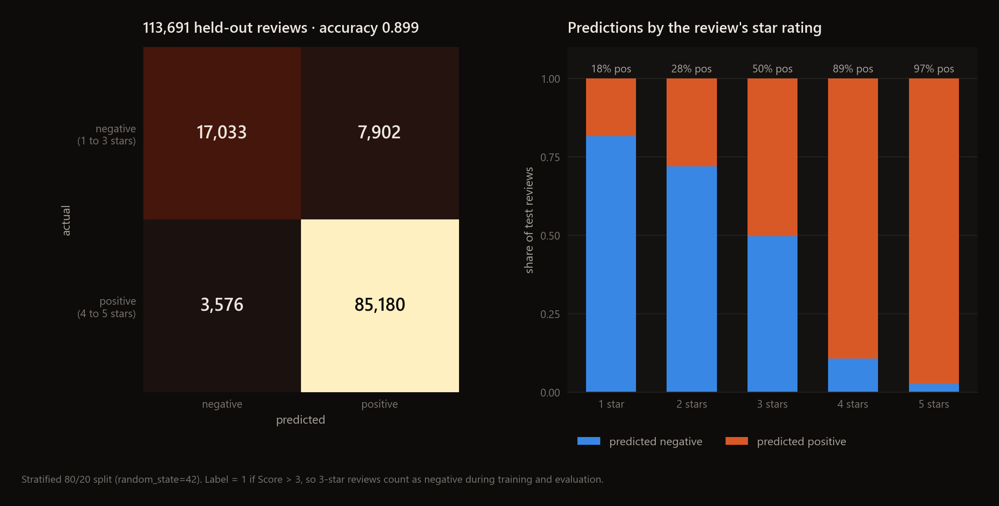
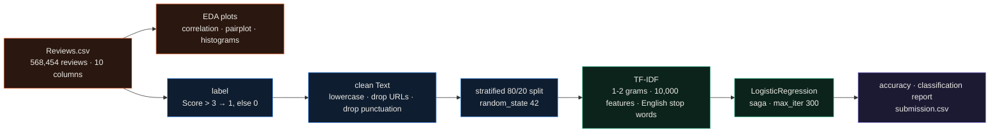
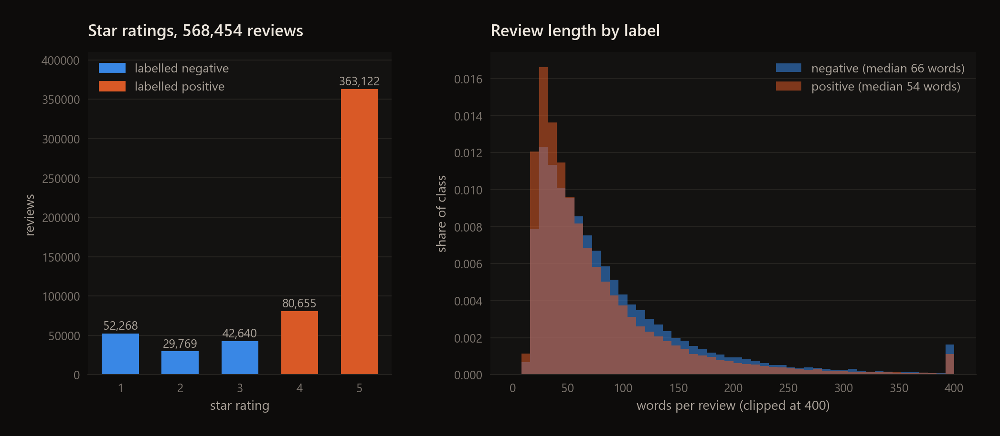
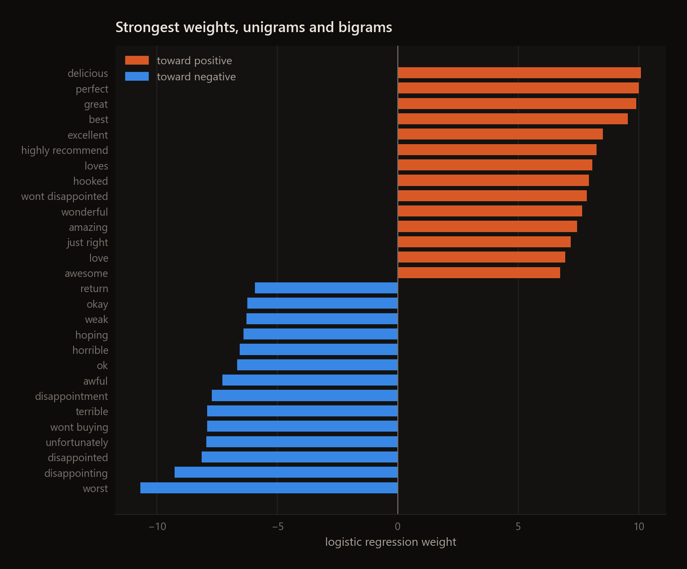
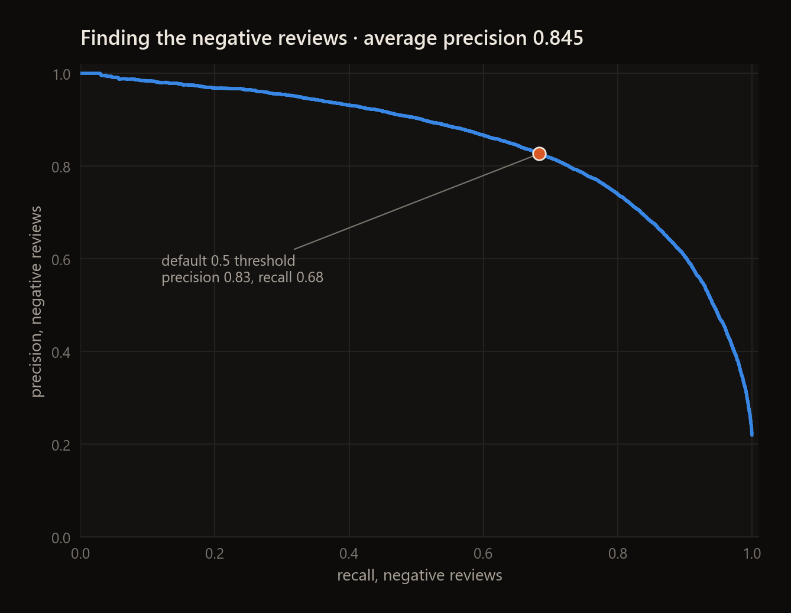

<div align="center">

# Amazon Fine Food Reviews Sentiment

**Positive vs negative sentiment for 568,454 Amazon food reviews: TF-IDF bigrams and logistic regression, evaluated on 113,691 held-out reviews.**




</div>

I wrote this on Kaggle as a single script. It labels a review positive when it has 4 or 5 stars and negative
otherwise, so 3-star reviews count as negative, then trains a logistic regression on TF-IDF unigrams and bigrams of
the review text. Before that it plots the numeric columns (a correlation heatmap, a pairplot and three histograms).
The right half of the figure above is the most useful view of the result: the model gets the ends of the star scale
mostly right and splits 3-star reviews down the middle.

## Highlights

- Logistic regression reaches 0.899 accuracy on 113,691 held-out reviews (the original version of this README said about 90%).
- Positive reviews are the easy class (recall 0.960). Negatives are 21.9% of the data, and at the default threshold the model finds 68% of them with precision 0.83.
- 3-star reviews cause 4,310 of the 11,478 test errors: the model calls 50.3% of 3-star reviews positive, but every 3-star review is labelled negative. Without the 3-star reviews, accuracy on the same test set is 0.932.
- "ok" and "okay" are among the strongest negative words, which is the 3-star label showing through. The bigram "wont disappointed" is a strong positive feature while "disappointed" on its own is a strong negative one.
- 39.3% of the test reviews have an exact duplicate text in the training set, mostly because the same review is listed under several variants of a product. On the 68,987 test reviews without one, accuracy is 0.888.

---

## How it works



Only the `Text` column goes into the model; the review summary, helpfulness votes and user IDs are not used. The
vectorizer is fitted on the 454,763 training reviews, and saga converges in 21 iterations.



Five-star reviews are 64% of the data. Negative reviews run a little longer than positive ones (median 66 words
against 54), but the two length distributions overlap almost completely.

## Results

Stratified 80/20 split as in the script, 113,691 test reviews (24,935 negative, 88,756 positive).

| class | precision | recall | F1 | test reviews |
|---|---|---|---|---|
| negative (1 to 3 stars) | 0.827 | 0.683 | 0.748 | 24,935 |
| positive (4 to 5 stars) | 0.915 | **0.960** | **0.937** | 88,756 |
| accuracy | | | **0.899** | 113,691 |



The weights read like a food review. Taste words dominate the positive side; disappointment, refunds ("return")
and lukewarm words ("ok", "okay", "weak", "hoping") dominate the negative side. The lukewarm words would be close
to neutral in a three-class setup, and here they absorb the 3-star reviews.



If the goal is to surface unhappy customers, the default threshold is too conservative. At 80% recall the precision is
still 0.74, so lowering the threshold catches many more negative reviews at a modest cost.

## Quickstart

```bash
git clone https://github.com/EllE961/Amazon-Fine-Food-Reviews.git
cd Amazon-Fine-Food-Reviews
pip install -r requirements.txt

python scripts/fetch_data.py           # downloads the SNAP original (116 MB) and writes data/Reviews.csv (about 1 min)
python amazon_reviews_sentiment.py     # EDA plot windows, accuracy and report, submission.csv (about 3.5 min)
python scripts/make_figures.py         # every number and figure in this README (about 4 min)
```

If you already have `Reviews.csv` from the Kaggle dataset (snap/amazon-fine-food-reviews), put it in `data/` and skip
the first step. On Kaggle the script reads it from `/kaggle/input/amazon-fine-food-reviews/` directly.

## Repository map

```text
amazon_reviews_sentiment.py   the whole pipeline: load, EDA plots, label, clean, split, TF-IDF, logistic regression, report
scripts/fetch_data.py         downloads finefoods.txt.gz from SNAP and converts it to the Kaggle Reviews.csv columns
scripts/make_figures.py       reruns the model and writes the figures and numbers in this README
docs/assets/                  figures used in this README
requirements.txt              versions I ran it with
data/                         Reviews.csv goes here (git-ignored, about 300 MB)
```

## Limitations

- The binary label folds 3-star reviews into negative. Half of them read as positive to the model, and they account for 4,310 of its 11,478 test errors. A three-class label, or dropping 3-star reviews, would be the honest fix.
- Duplicate review texts are not removed before splitting, so 39.3% of the test set has an exact copy in training. The unseen-only accuracy (0.888) is the better estimate.
- One split, default threshold, no tuning and no comparison model.
- The EDA part plots `Id` and `Time` alongside the helpfulness counts and the score, which says little about sentiment.
- `scripts/fetch_data.py` rebuilds the CSV from the SNAP original. It produces the same 568,454 rows and the same star counts as the Kaggle file, but I have not compared the two byte for byte.

Data: J. McAuley and J. Leskovec, "From amateurs to connoisseurs: modeling the evolution of user expertise through online reviews" (WWW 2013), distributed by Stanford SNAP and mirrored on Kaggle.

## License

MIT, see [LICENSE](LICENSE).
